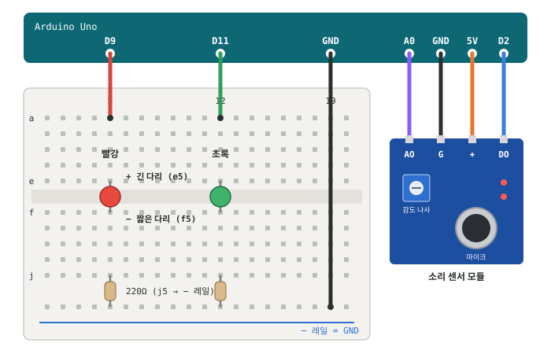
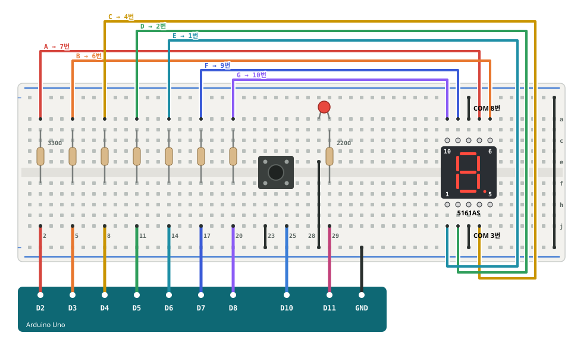
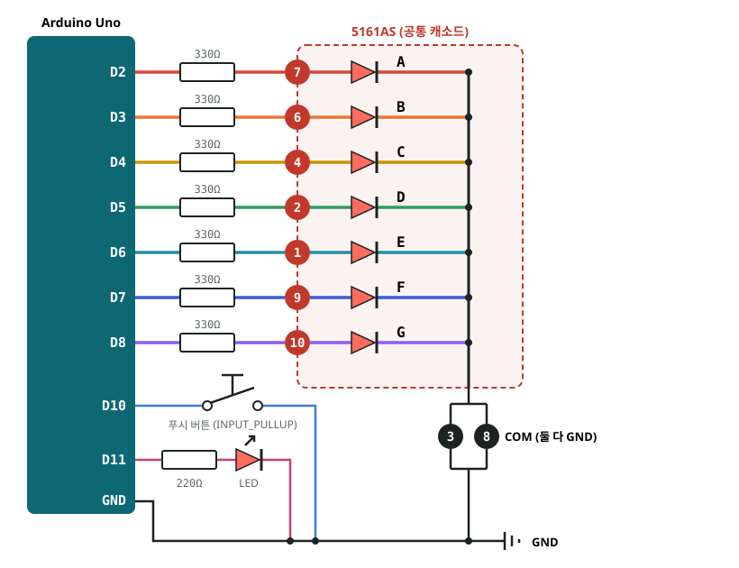
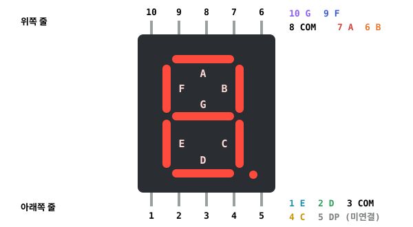
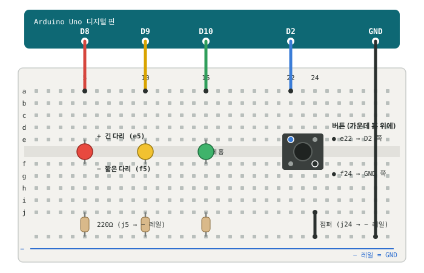

# Arduino Uno Lab

아두이노 우노 고급키트로 LED·버튼·가변저항·네오픽셀·소리 센서·7세그먼트를 다뤄 보고, **버튼으로 켜고 끄는 실물 신호등**과 **버튼 숫자 카운터**를 만든 학습 기록입니다.
코드는 AI 코딩 에이전트(Claude Code)와 함께 작성했고, `arduino-cli`로 노트북에서 보드에 바로 업로드했습니다.


> 자세한 설명과 코드 예시는 [STUDY_NOTES.md](STUDY_NOTES.md)에 정리했습니다.

---

## 오늘의 학습 키워드

### MCU · OS · GPIO

| 키워드 | 한 줄 정리 |
|---|---|
| **MCU** | CPU·메모리·입출력 핀이 칩 하나에 들어 있는 작은 컴퓨터. 우노의 MCU는 ATmega328P |
| **OS** | PC는 운영체제가 여러 프로그램을 관리하지만, 우노에는 OS가 없고 업로드한 프로그램 하나만 실행 (`setup()` 한 번 → `loop()` 무한 반복) |
| **GPIO** | 코드로 입력·출력을 정할 수 있는 범용 핀. `pinMode()`로 방향을 정함 |

### 입력과 출력

| 구분 | 동작 | 함수 | 값 |
|---|---|---|---|
| **디지털 출력** | 핀을 5V 또는 GND(0V)로 만든다 | `digitalWrite()` | `HIGH` / `LOW` |
| **디지털 입력** | 같은 노드의 전압을 읽고, 5V에 가까운지 0V에 가까운지 판단한다 | `digitalRead()` | 1 / 0 |
| **아날로그 입력** | 같은 노드의 전압을 숫자로 읽는다 (ADC, 10비트) | `analogRead()` | 0 ~ 1023 |
| **아날로그 출력** | PWM(펄스 폭 변조)으로 켜진 시간 비율을 바꿔 아날로그 값을 표현한다 | `analogWrite()` | 0 ~ 255 |

### 회로 결선

| 부품 | 결선 | 스케치 |
|---|---|---|
| **가변저항** | 양 끝 다리 → 5V, GND / 가운데 다리 → A0 | [pot_led](pot_led/pot_led.ino) |
| **LED** | 핀 → 220Ω → LED 긴 다리(+) / 짧은 다리(−) → GND | [TrafficLight](TrafficLight/TrafficLight.ino) |
| **버튼 (풀업)** | 핀 → 10kΩ → 5V, 버튼 → GND · 평소 `HIGH`, 누르면 `LOW` | [STUDY_NOTES §4](STUDY_NOTES.md#4-버튼-입력-풀업-풀다운-내부-풀업) |
| **버튼 (풀다운)** | 핀 → 10kΩ → GND, 버튼 → 5V · 평소 `LOW`, 누르면 `HIGH` | [STUDY_NOTES §4](STUDY_NOTES.md#4-버튼-입력-풀업-풀다운-내부-풀업) |
| **버튼 (내부 풀업)** | `INPUT_PULLUP` + 버튼 → GND · 외부 저항 필요 없음 | [ButtonRead](ButtonRead/ButtonRead.ino) |

### 버튼을 정확하게 읽는 방법

| 키워드 | 한 줄 정리 | 스케치 |
|---|---|---|
| **디바운싱** | 접점이 튕기는 채터링을 `millis()`로 50ms 동안 기다려 걸러낸다 | [button_count](button_count/button_count.ino) |
| **상태 변화 감지** | 현재값과 과거값을 비교해 `HIGH → LOW`로 바뀐 순간만 잡는다 | [button_click](button_click/button_click.ino) |
| **인터럽트** | D2·D3 핀 신호가 바뀌는 순간 ISR을 바로 실행한다 (`attachInterrupt`) | [button_interrupt](button_interrupt/button_interrupt.ino) |

### 네오픽셀

| 키워드 | 한 줄 정리 | 스케치 |
|---|---|---|
| **네오픽셀** | 신호선 하나(DIN)로 RGB LED 여러 개를 각각 제어. `Adafruit_NeoPixel` 라이브러리 사용 | [neopixel_gauge](neopixel_gauge/neopixel_gauge.ino) |

### 2일차 · 아날로그 센서와 7세그먼트

| 키워드 | 한 줄 정리 | 스케치 |
|---|---|---|
| **ADC 전압 환산** | `analogRead()` 값에 `5.0 / 1023`을 곱하면 실제 전압(V) | [pot_pwm](pot_pwm/pot_pwm.ino) |
| **소리 센서 AO / DO** | AO는 마이크 파형 그대로(아날로그), DO는 감도 나사로 정한 기준을 넘으면 바뀌는 신호(디지털) | [sound_toggle](sound_toggle/sound_toggle.ino) |
| **Peak-to-Peak** | 20ms 동안 AO의 최댓값 − 최솟값. 소리의 크기를 숫자로 본다 | [sound_green_red](sound_green_red/sound_green_red.ino) |
| **쿨다운** | 한 번 반응한 뒤 250ms 동안 새 소리를 무시해서 박수 한 번이 여러 번으로 세지지 않게 한다 | [sound_green_red](sound_green_red/sound_green_red.ino) |
| **7세그먼트 (공통 캐소드)** | LED 7개(A~G)의 − 쪽이 COM으로 묶여 있어서, COM은 GND에 연결하고 세그먼트 핀에 `HIGH`를 주면 켜진다 | [seven_segment_counter](seven_segment_counter/seven_segment_counter.ino) |
| **비트 패턴** | 숫자마다 켤 세그먼트를 1바이트로 저장(`0x3F` = 0)하고 `bitRead()`로 한 비트씩 꺼내 출력 | [seven_segment_counter](seven_segment_counter/seven_segment_counter.ino) |
| **Wokwi** | 브라우저에서 아두이노 회로와 코드를 시뮬레이션하는 도구. 회로가 `diagram.json`으로 저장됨 | – |

---

## 진행 과정

### 1일차 (10/19) · LED, 버튼, 신호등

#### 1. 아두이노 고급키트 구성품

우노 보드, 브레드보드, 점퍼선, LED, 저항, 버튼, 가변저항, LCD, 서보·스텝 모터, 리모컨, 각종 센서가 들어 있는 키트로 시작했습니다.


#### 2. 신호등 회로 연결

LED 3개(빨강·노랑·초록)를 220Ω 저항과 함께 브레드보드에 꽂고, 4다리 푸시 버튼을 가운데 홈에 걸쳐 연결했습니다.


#### 3. 토글 기능 추가

버튼을 누를 때마다 신호등 전체가 꺼지고, 다시 누르면 초록불부터 다시 시작합니다.


[원본 영상 보기 (mp4)](assets/03-toggle-demo.mp4)

### 2일차 (10/20) · 아날로그 센서, 7세그먼트

#### 4. 가변저항 전압 읽기

`analogRead()` 값(0~1023)을 PWM(0~255)으로 바꿔 LED 밝기를 조절하고, 시리얼 모니터에 실제 전압도 함께 출력했습니다.

```
ADC:512 PWM:127 Voltage:2.50
```

전압 = `raw × 5.0 ÷ 1023` · 코드: [pot_pwm](pot_pwm/pot_pwm.ino)

#### 5. 소리 센서로 초록·빨강 LED 번갈아 켜기

박수를 칠 때마다 초록 → 빨강 → 초록 순서로 LED가 바뀝니다. 센서의 DO(감도 나사로 정한 기준)와 AO 파형의 크기(20ms 동안 최댓값 − 최솟값) 중 하나만 넘어도 소리로 인정해서 감도를 높였습니다.



코드: [sound_toggle](sound_toggle/sound_toggle.ino) (LED 1개 토글) → [sound_green_red](sound_green_red/sound_green_red.ino) (초록·빨강 번갈아)

#### 6. 7세그먼트 카운터 (5161AS)

버튼을 누를 때마다 숫자가 0 → 9로 올라가고, 0일 때만 LED가 켜집니다. 세그먼트마다 330Ω 저항을 달고, 공통 캐소드(COM) 다리 두 개를 모두 GND에 연결했습니다.



| 전기 회로도 | 5161AS 다리 번호 |
|---|---|
|  |  |

| Arduino | 세그먼트 | 5161AS 다리 |
|---|---|---|
| D2 · D3 · D4 · D5 · D6 · D7 · D8 | A · B · C · D · E · F · G | 7 · 6 · 4 · 2 · 1 · 9 · 10 |
| GND | COM | 3 · 8 (둘 다) |
| 미연결 | DP | 5 |

코드: [seven_segment_counter](seven_segment_counter/seven_segment_counter.ino)

---

## 신호등 회로



| 우노 핀 | 연결 | 코드 |
|---|---|---|
| D8 | 빨강 LED → 220Ω → GND | `RED_PIN = 8` |
| D9 | 노랑 LED → 220Ω → GND | `YELLOW_PIN = 9` |
| D10 | 초록 LED → 220Ω → GND | `GREEN_PIN = 10` |
| D2 | 푸시 버튼 → GND (대각선 다리 사용) | `BUTTON_PIN = 2`, `INPUT_PULLUP` |

- 신호 순서: 초록 → 노랑 → 빨강, 각 0.5초
- 버튼: 누를 때마다 신호등 ON/OFF 토글
- `delay()` 없이 `millis()`로 시간을 재서 버튼 입력을 놓치지 않습니다

코드: [TrafficLight/TrafficLight.ino](TrafficLight/TrafficLight.ino)

---

## 스케치 목록

배운 순서대로 정리했습니다. 1일차의 `blink_fast`, `TrafficLight`와 2일차 스케치 4개는 실제 우노 보드에 업로드했고, 나머지 1일차 스케치는 Tinkercad Circuits 시뮬레이션용으로 작성했습니다.

| 스케치 | 내용 | 핵심 개념 |
|---|---|---|
| [Blink](Blink/Blink.ino) | A0에 꽂은 LED를 1초 간격으로 깜빡임 | `pinMode`, `digitalWrite`, `delay` |
| [LED_Pin3](LED_Pin3/LED_Pin3.ino) | D3 핀으로 LED 켜고 끄기 | GPIO 출력 |
| [ButtonRead](ButtonRead/ButtonRead.ino) | 버튼 상태를 시리얼 모니터에 출력 | `INPUT_PULLUP`, `digitalRead` |
| [PotRead](PotRead/PotRead.ino) | 가변저항 값 읽기 | `analogRead` (0~1023) |
| [button_count](button_count/button_count.ino) | 누른 횟수 세기, 5번마다 LED 토글 | 현재값·과거값 비교, `millis()` 디바운스 |
| [button_click](button_click/button_click.ino) | 더블클릭 → ON, 길게 누르기 → OFF, 한 번 → 무시 | 클릭 패턴 판별 |
| [button_interrupt](button_interrupt/button_interrupt.ino) | 누를 때와 뗄 때마다 LED 토글 | `attachInterrupt`, `volatile`, ISR |
| [pot_led](pot_led/pot_led.ino) | 가변저항으로 LED 밝기 조절 | `map`, `analogWrite`, PWM |
| [neopixel_gauge](neopixel_gauge/neopixel_gauge.ino) | 가변저항으로 네오픽셀 8구 게이지 채우기 | `Adafruit_NeoPixel`, `int` 오버플로 |
| [blink_fast](blink_fast/blink_fast.ino) | 내장 LED 깜빡임 속도 실험 (0.1초 → 0.001초) | 잔상 효과, PWM 원리 |
| [TrafficLight](TrafficLight/TrafficLight.ino) | 버튼 ON/OFF 신호등 | `millis()` 상태 전환, 디바운스 |
| [pot_pwm](pot_pwm/pot_pwm.ino) | 가변저항으로 LED 밝기 조절 + 전압 출력 | ADC → 전압 환산, `F()` 매크로 |
| [sound_toggle](sound_toggle/sound_toggle.ino) | 소리가 날 때마다 LED 토글 | 소리 센서 AO/DO, 쿨다운, Peak-to-Peak |
| [sound_green_red](sound_green_red/sound_green_red.ino) | 박수마다 초록·빨강 LED 번갈아 켜기 | 상태 변화 감지, DO + AO 감도 보강 |
| [seven_segment_counter](seven_segment_counter/seven_segment_counter.ino) | 버튼으로 7세그먼트 숫자 0~9 증가 | 공통 캐소드, 비트 패턴 `bitRead`, 디바운스 |

---

## 업로드 방법

```powershell
# 연결된 보드와 포트 확인
arduino-cli board list

# 컴파일하고 바로 업로드 (우노, COM3)
arduino-cli compile --fqbn arduino:avr:uno --upload -p COM3 TrafficLight
```

코드 파일을 저장하는 것만으로는 보드가 바뀌지 않습니다. 고친 뒤에는 꼭 다시 컴파일하고 업로드해야 합니다.
